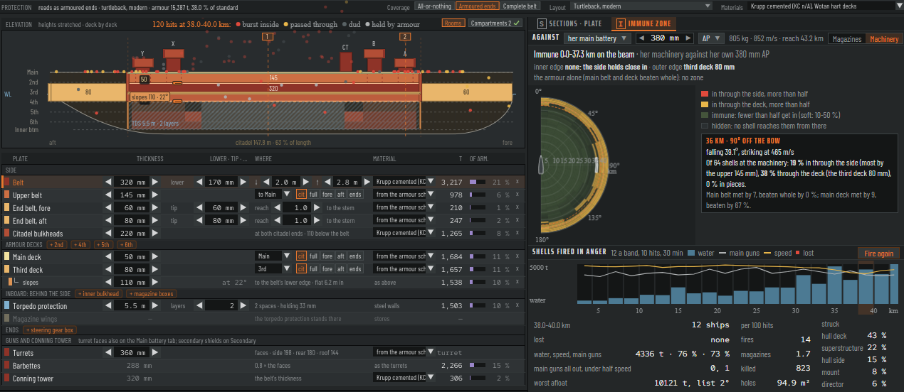
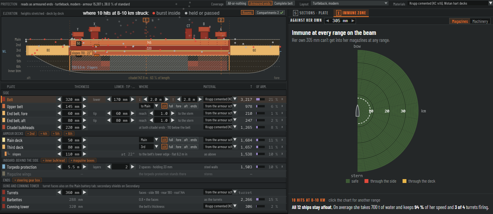
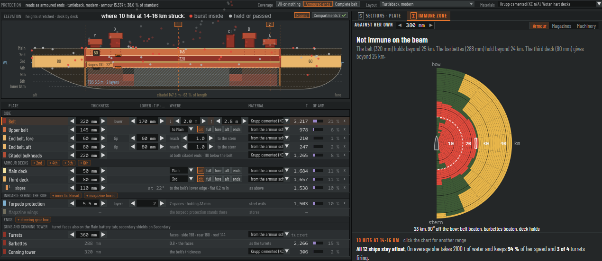
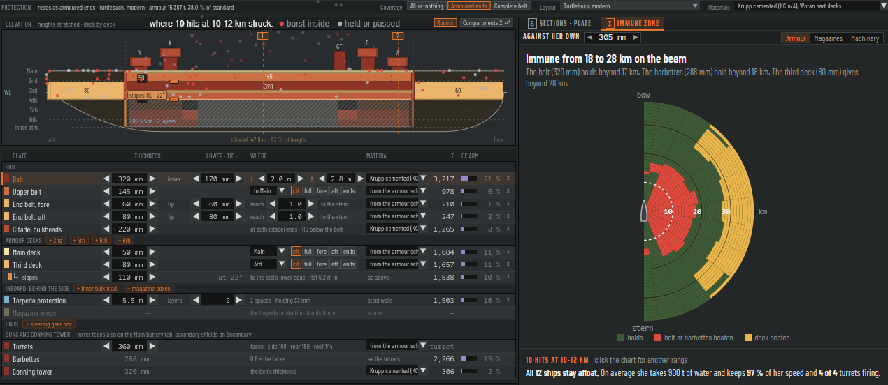

# Immune zone and shells fired in anger (plan, 2026-11-14)

**Status:** the user's answers in (2026-11-14, "Decisions" at the end). IZ0, IZ1 and IZ2 built 2026-11-14 ("IZ0 and
IZ2: how they went", "IZ1: the record"); the mockup (IZ3) in its third pass after two reviews ("IZ3: the mockup"); the port (IZ4) next.

The Protection tab has carried a greyed placeholder since its first review (protection.md, 2026-10-11): "Immune zone
and shells fired in anger · against her own 380 mm · NEEDS THE PENETRATION MODEL". The penetration model has been in
since 2026-10-17 (Thompson, its Cardano inverse, Lambert-Jonas, caps, shatter, break-up, fuzes: shells-armour-damage.md
P0-P7), and the damage behind it since E0-E8. This plan fills the panel.

Two readouts, one question each:

- **The immune zone:** at which ranges and target angles does a gun's shell fail to reach her vitals, through the side
  or through the decks? The designer's chart, the one the USN drew from 1929 on.
- **Shells fired in anger:** what do hits of that gun do to her, range by range across the whole fight? Not plates
  beaten, but ships: holes, fires, guns silenced, magazines, men, ships lost. The zone says where her vitals are safe;
  this says what that safety is worth, and how she fares inside it: even Yamato is felled by WW1 battleships if the
  range is short enough.

## What's already there

Everything below is built and tested; the plan adds a readout over it, not a model.

| Piece | Where | Used for |
|---|---|---|
| The shell's flight: fall and striking speed at a range, from a target angle | `Ballistics.Step` (now through `RangeTable`, below) | both |
| The tracer: a line through the ship's plates, parts and watertight cells | `ShipTracer.Trace`, `HitPath` (`CellIn` crossings carry the cell, `CellRow.Room` its room kind) | both |
| The terminal walk, plate by plate, with the plate lots, caps, shatter, break-up, turn, glance and fuze | `Terminal.Resolve` | the immune zone |
| A hit through the world's own damage system | `DamageSystem.StrikeOut`, `ShotRange` | shells fired in anger |
| N hits drawn uniformly over the ship's outline as the shell sees it, run on fresh ships, settled for flooding and fire | `GivenHits.Run`, its `Aim` and `Report` (`shipgen hits`) | shells fired in anger |
| A battery's shells from the design (its family and blocks at its calibre) | `Ammunition.ResolveBattery` (Shipgen), into rows by `Loadout.ShellOf` | the "against" picker |
| A design compiled into a class | `ShipClassCompiler.Compile` | both |

The matchup's profiles (`MatchupProfile.SideArmour`/`DeckArmour`) are a quick per-class estimate the AI asks every
think. They are not the immune zone and the immune zone doesn't use them (one model per thing: the zone walks real
shells through `Terminal.Resolve`). A test later checks the two don't drift far apart (IZ5).

## 1. The immune zone

**The armour first** (decision 7, 2026-11-14: "Usually at short ranges people can't reach magazines directly due to
angles so what is more interesting is if the belt armor can hold and are barbettes penetrated"). The zone's own view
aims shells at three plates, each from its own shells: her main belt (its thickest plate, on the side or inside it,
struck from outboard; every shell down the one line through its centre, halfway up its part over the waterline:
decision 9), her main battery's barbettes where they stand clear of the hull, and her main armour deck
(`Armour.MainDeck`'s, with its slopes, struck from above). A plate is beaten by a shell that comes through it whole, not
broken, not glanced off. The belt and the barbettes hold from the range out to which half get through; the deck gives
from the range at which half do; the armour's zone is between (`ImmuneZone.ArmourEdges`), the classic one. The vitals
(below, decisions 1 and 2) are the second view, a click away.

### The vitals

For a gun's shell (a battery of hers, at its calibre or another, its AP by default, any kind it carries on a pick), at each
range out to the gun's reach and each target angle (the line of fire off her bow, 0-180°, one side; she's symmetric
enough):

1. **Shells at the vitals.** Lines of flight drawn over her outline as the shell sees it, kept only if the line, unstopped,
   would enter a vital space. Vitals are cells holding a magazine (shell rooms are magazines in the model: the
   magazines' zone) or a boiler or engine room (the machinery's). The USN gave both zones; so do we, two zones, each from its own shells (decision 2).
2. **Each shell walked** through `Terminal.Resolve` on an undamaged ship, upright on her design waterline: the same walk
   a hit in battle takes, with its rolls (the plate's lot, shatter, break-up, the fuze). No effects, no world: the
   walk only says where the shell went and whether it was whole.
3. **Reached** if the shell enters a vital cell whole, filler in it, before it stops (or bursts inside one). Shells
   broken up on the way don't count; their share shows on hover (decision 1).
4. **Through the side or the deck:** each shell that reached is put down to the heaviest plate it beat on the way in,
   by how the plate lies, not its name: within 45° of level it's the deck (an armour deck, a turtleback's slopes, a
   grating), steeper the side (a belt, an inclined belt, a bulkhead, a barbette).
5. **The edges.** At each angle, the inner edge is the range out to which more than half the shells at the vitals get
   in through the side; the outer edge, the range from which more than half get in through the deck. Between them she's
   immune; with the inner edge past the outer, she has no zone at that angle (Iowa against her own gun without the
   outer hull's credit, armor/00 §9 row 12). Half is the classic limit at the mean plate; the chart shades the band where
   the share is between 10% and 90%, so a soft edge looks soft (decision 3).

What it doesn't count, on purpose: hits on the ends, upperworks and turrets (the zone is about the vitals), the ship's
own motion (roll and heel would move the deck edge a little), and damage from earlier hits. Shells fired in anger
covers all of those.

**Hidden cells.** Vitals deep under the waterline can't be reached at all by a flat fall: the shell meets the sea farther
out than it runs under water, or every line to them passes the side above them. A cell whose first 8 shells found no
line is hidden: out of the shell's sight, as good as immune, drawn as its own shade.

Cost (measured, IZ0): a range step of 1 km to the gun's reach, 13 angles every 15°, both zones: about 1,100 cells for
a 15" gun. A shell costs 80-110 µs on one thread, almost all of it the tracer (its 5 cm march through the hull), so 16
shells a cell is about 1.1-1.6 s on one thread, a quarter of that on four. It refines in passes (16, then more) so the
chart appears at once and sharpens; the shells a cell come down until it's fast enough (the user, 2026-11-14).

**Common random numbers.** Every build of the design uses the same seed, so one cell's lines and rolls are the same
before and after an edit: a 10 mm thicker belt moves the edge because the belt did, not because the dice did.

### How it looks (the mockup decides)

- **The chart:** a half-polar plot, USN style. Her plan small at the centre, bow up; the target angle around it, the
  range out from it to the gun's reach in rings every 5 km (or kyd, by the designer's units). Each cell coloured by what
  happens there: through the side (inside), immune, through the deck (outside), beyond reach. All colours are `Theme`
  tokens. The magazines' and the machinery's zones as two outlines, the selected one filled.
- **The line:** "Immune 20.4-26.7 km on the beam against her own 380 mm APC · magazines", or "No immune zone: the
  belt is beaten out to 27 km, the deck from 24 km".
- **Hover a cell:** the range and angle, the fall and striking speed, the share that reached and through what ("62%
  through the belt, 330 mm at 18°; 4% through the slope"), the share broken up.
- **The range axis is shared** with fired in anger's strip under it (below): a range band lines up with its ring.
- **The plate that sets each edge** is named under the line ("inner edge: the belt over the magazines; outer edge: the
  2nd deck's 80 mm over the forward magazines"). That's the knob the designer turns next.

## 2. Shells fired in anger

A sweep across the fight, not one shot: the zone says where her vitals are safe, this says what she suffers at every
range, inside the zone, short of it and past it (decision 6).

**The run.** `GivenHits.Ship`, the step `shipgen hits` runs too, once a ship: bands every 2 km from 2 km to the gun's
reach. In a band each ship takes **10 hits** at one range in the band and one target angle, the chart's 13 angles taken
in a spread order (0, 75, 150, 30, 105, ...) so a few ships see them all round; the hits drawn uniformly over her outline as the shell sees it,
through the world's own damage system, then the ship **settled 30 minutes** for her flooding and fires. Ships are added
a round at a time over every band, so every band fills together and the strip sharpens as it runs; it stops at the
ships a band asked, or when stopped. Each band is a world of its own, so a band's ships are the same on any threads. Hits a ship (5, 10, 20, 40) is a stepper. Nothing new in the
model; the readout is new.

Same seed for every build of the design, as the zone: a run before an edit and one after differ by the edit.

What it shows:

- **The strip,** under the chart, a column a range band, in the chart's units: the ships lost of those run (a bar split
  by how: magazine, foundered, capsized, broken), and beside it those with their main guns out and those under half
  speed. Inside the inner edge this is where Yamato dies to 12" shells; the bands in the zone show what the upperworks
  and the ends cost her there. Hovering a band highlights its ring on the chart.
- **A band picked** (a click on its column) shows its detail:
  - **the dots:** each hit a dot on the Protection tab's own elevation (and the half-sections), where it first met her,
    coloured by its class (16's: burst inside, passed through, dud, held by armour). The dots are the run, not a
    picture of it;
  - **by where:** belt, deck, upperworks, turrets and barbettes, ends; for each, the share held, burst inside, passed
    through;
  - **per 100 hits:** fires started, holes under the water (m²), men killed and wounded, turrets jammed or out,
    magazines set off (and how: flash, burst, fire);
  - **the ships:** the water and list of the worst still afloat, and the crew out of action against hits (the
    `CurveOut` the bench already keeps).

Cost (measured, IZ2): a ship with her 10 hits and 30 minutes' settle is about 30 ms on one thread, the settle most of
it; 16 bands of 8 ships, 128 ships, is about 4 s on one thread, 1 s on four. The ships a band come down until it's fast
enough, not the model. Every world in the process now shares its guns' ballistic tables
(`BallisticTable.Shared`): each band's world would otherwise build them again, 2-4 s of work a world. It runs on a
click (Fire), never by itself on an edit; an edit marks the result stale (greyed, "before the last edit") until fired
again.

## 3. The against picker

Against her own guns (decision 5): setting up a trial with your own gun is easier than finding a foreign one.

- **The battery:** hers, the main first, and its shell kind (AP by default; common, HE as it carries them).
- **The calibre:** a stepper on it, at the battery's own to start. Another calibre is her own shells at that calibre: a
  copy of the design with the battery's calibre set, through `Ammunition.ResolveBattery` (her shell family and blocks,
  her gun block), into a `ShellTypeRow` by the same conversion `Loadout` uses (made one shared function, not copied).
  The guns' elevation is her mounts'. Nothing is built but the shells; the design itself is untouched.

So "a WW1 12" against Yamato" is Yamato's own family at 305 mm: not a Dreadnought's shell, but the same question. The
pick (battery, kind, calibre) is kept in the session, not in the design.

## Where the code goes

- **`Fleetwright.Sim.Combat/ImmuneZone.cs`** (built): a class and a shell in, the grid of cells out for each vital
  zone (shares by side, deck, broken; the plate that let most through), by passes, cancellable. No world: the walk
  only, on an intact `ShipCondition` (so coal and oil still slow shells). Pure, no GPU, no UI; allocates per run, never
  per walk. Its falls from **`RangeTable`** (Ballistics.cs): the gun's flights at its own speed every half degree, a
  whole range table for a few dozen flights where a `BallisticTable` integrates nine at every half degree.
- **`Fleetwright.Sim/AngerRun.cs`** (built): the sweep over `GivenHits.Ship` by band, with progress and a cancel; each
  band's `GivenHits.Report` (now with the ships under half speed and the worst afloat) and each hit's dot.
- **The shells at a calibre** (built): `Loadout.ShellsAt`, by `Ammunition.ResolveBattery` and `Loadout.ShellOf` (the
  loadout's own conversion, made public).
- **`Fleetwright/Designer/ImmuneWorker.cs`:** compiles the design's class off the render thread (cached by the design
  hash), runs the zone on a couple of threads, newest request wins, as `DesignProbes` does; the sweep on a click.
- **`Fleetwright/Designer/DesignerScene.Immune.cs`:** the panel, the strip and the dots.
- **`shipgen immune DESIGN [--battery main|secondary] [--index I] [--calibre MM] [--kind ap|common|he]
  [--vitals mag|mach] [--shells N] [--passes] [--threads N] [--cell VITALS:KM:ANGLE] [--anger SHIPS [--per-ship K]
  [--settle MIN]]`** (built): the chart as a table, the edges by angle and the plates setting them, and the cost; `--cell`
  prints one cell's walks; `--anger` the strip as a table. The anchors (IZ1) to come.

## Steps

| Step | What | Done when |
|---|---|---|
| IZ0 | `ImmuneZone`, the shells at a calibre, and `shipgen immune` | the bench prints both zones for bismarck, yamato, dreadnought against their own guns and other calibres; tests: deterministic, the same with 1 or N threads, a thicker belt never moves the inner edge out, a thicker deck never moves the outer edge in, the shells at the battery's own calibre equal the loadout's |
| IZ1 | The anchors, as history checks (never set): bench-only designs with SoDak's and Iowa's schemes (`shipgen/anchors/`, not game assets; research 08's table, armor/00 §9 row 12), `shipgen immune --anchors` | done: the numbers beside the record, the gaps named ("IZ1: the record"); no tuning. North Carolina's studies left out: their 14"/50's 680 kg shell isn't a family of ours at 356 mm |
| IZ2 | `AngerRun`: the sweep, progress, cancel, the summaries, the dots; its cost measured | `shipgen hits` unchanged, byte for byte (done); the same bands on any threads (done). The guess that Yamato against 305 mm is lost at short range didn't hold: see "how they went", for the user |
| IZ3 | The mockup, `immune.html` (the Protection tab's pane, 1270 × 552 at 1080p) over a capture of the tab: the chart, the strip, the band, the dots | drawn ("IZ3: the mockup"); the user's review |
| IZ4 | The port: worker, panel, chart, strip, dots, picker; `-designer-ui=immune:...` for screenshots | on bismarck and dreadnought, a belt edit moves the edge within a second; captures checked |
| IZ5 | Beyond the tab: the line in the particulars and the ship card; the matchup profiles checked against the zone (a test in a loose band); the Overview levers' "immune zone" hints made real numbers if the probes can afford it | each as the user picks |

IZ0 and IZ2 can run together; the mockup waits for their numbers so it's drawn from real zones and runs.

## IZ0 and IZ2: how they went (2026-11-14)

- **The first numbers were wrong three ways**, each found by printing one cell's walks (`--cell`): the tracer's path was
  made with a 16-crossing buffer copied from `ShotRange`'s probe, so it kept only the line's last 16 crossings and the
  walk began inside her; a cell gave up for good after one shell found no line; and the heaviest plate was looked for
  before the crossing into the vitals by its T, which skipped the armour deck lying at the same point. All three fixed.
- **Sampling.** A space of the vitals is picked by the area of its box's outline across the line of flight and a point
  drawn in it; the line is kept one time in as many of the vitals' boxes as it meets, which makes the lines even over
  them all without tracing to find which one comes first. Sure misses (the box missed, the sea met farther out than the
  shell runs under it) never reach the tracer. A line that meets nothing before her is the hit's own path already, so
  only shells that strike under water are traced twice. 330 → 106 µs a shell on Bismarck, the same zone.
- **First readings,** against her own main battery's AP, broadside: Dreadnought's machinery open through the belt out to
  6.5 km, her magazines closed at every range by the slopes behind it, her decks never beaten within her guns' 18 km;
  Bismarck immune from 0 to 37 km over her machinery (the turtleback) and nearly everywhere over her magazines; Yamato
  1.8-34 km over her machinery, and her own family at 305 mm getting in nowhere. In the sweep, Yamato against her own
  family at 305 mm lost one ship in 128 with 10 hits each (a magazine at 24-26 km), and with 40 hits each 8 of 128:
  none inside 6 km (none of her guns out, none under half speed there either: her belt, slopes and 650 mm faces hold a
  12" close in), magazines at 6-22 km, capsized at 8-10 and 28-30 km. Not what decision 6's "felled by WW1
  battleships if the range is short enough" expects: for the user, not tuned. Checked against the record in IZ1.

## IZ1: the record (2026-11-14)

The record's immune zones are the classic ones: the range out to which the main belt is beaten by a whole shell, and
from which the main deck is. Ours (decision 1) asks more: the shell must get into the vitals whole. So the zone keeps
both: per cell, the shells that met her main belt (her thickest plate lying as the side) and her main deck (her thickest
lying as a deck) and of them those through it whole (not broken, not glanced off), whether or not they then reached the
vitals; `Edges(..., beaten: true)` gives the classic edges. The chart's hover can say both ("the belt is beaten out to
18 km, but the shells burst before the machinery").

Two bench-only designs on Colorado's hull with the US 1941 family's AP Mk 8 (1,223 kg, 762 m/s from a 16"/50), each
against her own gun, broadside, 128 shells a cell:

| Scheme | Record | Classic edges (ours) | Vitals (ours): magazines, machinery |
|---|---|---|---|
| Iowa: 307 mm Class A at 19°, inside 38 mm STS; decks 38, 152, 16 mm | USN 23.6-27.4 kyd = 21.6-25.1 km | 18.4-26.2 km | never reached; 3.5-30.9 km |
| South Dakota: 311 mm at 19° inside 32 mm; decks 38, 146 mm | research 08's own model: 23.0-26.5 km | none: belt beaten to ~31 km, deck from ~26 km | never reached; 9.0-26.9 km |

- **The decks hold about right:** the outer edges within 1-2 km of both figures (vanilla Thompson, shells-armour-damage.md).
- **The belt sits either side of the cap's threshold.** Iowa's 38 mm outer hull takes the Mk 8's cap off and the bare
  nose then shatters on the Class A, so her belt holds 3 km farther in than the USN had it; South Dakota's 32 mm is
  under the threshold, the capped shell meets the belt, and it's beaten 8 km farther out than research 08's figure
  (which took the hull as a spaced plate, Okun's rule, not as a decapping one). This is armor/00 §9 row 12's "most
  important IZ knob", now on both sides of it: a step in the physics, the threshold the cap comes off at, not a rule of
  ours. For the user: whether the decapping plate's step wants a softer edge (no hard switches) is a terminal-model
  question, not this tab's.
- **The vitals' zone is much wider than the classic one**, as decision 1 makes it: shells that beat the belt at 15-20 km
  mostly burst in the space above the splinter deck before the machinery (the outer hull starts their fuze), and the
  magazines, deeper, are never reached at all by her own gun.

## IZ3: the mockup (2026-11-14)

`immune.html`: the Protection tab's pane at 1920 × 1080 (1270 × 552). Its left half is the game's own pane
(`png/immune-base.png`, a capture) under the dots; the right column is the new tab, drawn live from real runs
(`immune-data.js`: `shipgen immune bismarck --calibre 380|305 --shells 64 --json` and `--anger 12 --json`). URL:
`?cal=305`, `?v=mag|mach`, `?km=N` (the range picked), `?hover=R,A`, `?tab=plate` (the column as today).

**First pass: too dense** (the user, 2026-11-14: "Way too information dense ... I did like the angle and distance style
chart but the bottom chart was not intuitive at all"). It had the shell's figures, two edge lines, a legend of four,
a hover box of five lines, a strip of water bars with lines for guns and speed, and three tables for the band picked.

**Second pass: the chart is the picture, the rest in words** (approved as the direction, 2026-11-14: "that looks better
now").

- **Against her own** ◀ 380 mm ▶ and Magazines | Machinery. Nothing else in the bar.
- **A headline** ("Immune from 0 to 37 km on the beam", "Immune at every range on the beam", "Not immune on the beam")
  and one line on what sets the edges ("Beyond 37 km they come down through the third deck 80 mm").
- **The chart**, big: three colours only, safe (fewer than half get in, or nothing reaches them), through the side,
  through the deck. Rings every 10 km, bow up. Hover: one line by the cursor ("31 km, 60° off the bow: 28 % get in").
- **Click the chart to pick a range**: a dashed ring, and under the chart in a sentence what her own hits do there
  ("10 hits at 14-16 km: All 12 ships stay afloat. On average she takes 2,100 t of water and keeps 94 % of her speed
  and 3 of 4 turrets firing.").
- **The dots** on the elevation for that range, two kinds: burst inside her, or held or passed.
- Gone: the shell's mass and speed, the armour-alone edges, the soft shading, the hidden shade (folded into safe), the
  strip, the band tables, the hits by where. The bench keeps all of it.

**Third pass: the armour first** (decisions 7 and 8).

- **Armour | Magazines | Machinery**, Armour first. In the Armour view red is the belt or the barbettes beaten, amber the
  deck beaten, green holds.
- **The headline** is the armour's zone ("Immune from 22 to 33 km on the beam"), and the line under it each plate in
  turn: "The belt (320 mm) holds beyond 21 km. The barbettes (288 mm) hold beyond 22 km. The third deck (80 mm) gives
  beyond 33 km."
- **Hover:** "20 km, 90° off the bow: belt 48 %, barbettes 56 %, deck 0 % through".
- **Sections · plate** loses the placeholder line.

**Fourth pass: less noise** (the user, 2026-11-14: "Belt can be just aimed at the center of it once, no need to do any
fancy stuff with it. Any ideas how to reduce the noise? Seeing 2% penetration at some points at specific distance does
not really give any actionable insights.")

- **The belt down one line** through its centre (decision 9). Its shells differ only by the plate's own lot and the
  walk's rolls: on the beam Bismarck's belt is beaten by every shell out to 18 km and by none past 27; Iowa's out to
  17 km and none past 20. It's also the cheapest target (one trace a shell): the armour at 16 a cell fell from 4.6 to
  2.7 s on one thread.
- **The same shells at every range** of a target and an angle (their aim across the outline, the plate's lot, the
  rolls). A shell gets through out to some range and not beyond, so a share falls (or rises) with range as the physics
  makes it; before, each cell drew its own and neighbours disagreed by chance.
- **Words, not percentages:** the hover says "belt beaten, barbettes mostly holds, deck holds" (under 10 % holds,
  under half mostly holds, under 90 % mostly beaten, else beaten), on the line under the chart; the cell is outlined.

**Fifth pass: the barbettes and the deck aimed too, more shells where it matters** (the user, 2026-11-14: "Let's do
the same for barbettes and the deck. You can toss bit more on the areas where it matters more"; decision 10).

- **The barbettes:** a line through each main barbette's centre, halfway up the part over her deck, the shells taking
  them in turn. **The deck:** five points along the main deck's longest stretch on the centreline (one point alone put
  the deck's answer on a 150 mm secondary turret that stood over it from the beam).
- **More shells where it matters** (`ImmuneZone.Refine`): after the first pass, a cell with its share between 10 % and
  90 %, or beside a cell on the other side of half (the next range or angle), is filled further. A refined cell is the
  same cell filled at once (the same shells: a test). The designer's default: 8 a cell, then 32 where it matters; for
  Bismarck's armour about 2.4 s on one thread for the first pass and 1 s more for the refining (about 0.6 s and 0.25 s
  on four).
- **What it does to the answers.** Aimed at the centre, a barbette is struck square, the worst case for a round plate:
  sampled over its face, most hits came in oblique and glanced. Bismarck's barbettes are now beaten out to 24 km at
  almost every angle by her own 380 mm (half of them were, sampled). The deck's centreline is beaten from 25 km on the
  beam where the whole deck with its slopes held to 33-35. Together her zone against her own guns closes: "Not immune on
  the beam" (a zone under 1 km isn't called one). Against her own family at 305 mm: immune 18-28 km.

Cost: the three plates at 16 shells a cell are about 4.6 s on one thread for Bismarck (190 µs a shell: the belt's lines
cross more of her than the vitals' did), so the designer starts at 8 a cell (about 0.6 s on four threads) and refines.

## Decisions (user, 2026-11-14)

1. **Reaching the vitals:** the shell enters a vital space whole, filler in it, or bursts inside one. A shell broken up
   on the way doesn't count; the chart shows its share on hover.
2. **Two zones,** magazines and machinery, each from its own shells.
3. **The edge at half** the shells at the vitals getting in, the 10-90% band shaded.
4. **The facts pane gets two tabs,** Plate and Immune zone; the dots draw on the elevation whenever there's a run.
5. **Against her own guns,** a calibre change using her own shells: "it's easier to set up an impact test using your own
   gun than go search for a specific foreign weapon." No foreign designs, no free reference gun.
6. **Fired in anger is a spread** over ranges and angles, not one cell: "we want to know the immunity zone. Even
   Yamato is felled by WW1 battleships if the range is short enough."
7. **The armour first:** whether the belt holds and the barbettes are beaten, more than whether shells reach the
   magazines, which at short range the angles rarely allow (section 1).
8. **The tab takes the whole right column**, and the placeholder line goes from Sections · plate.
9. **The belt aimed at its centre**, every shell down the one line: "no need to do any fancy stuff with it."
10. **The barbettes and the deck aimed the same way**, and more shells where it matters.
