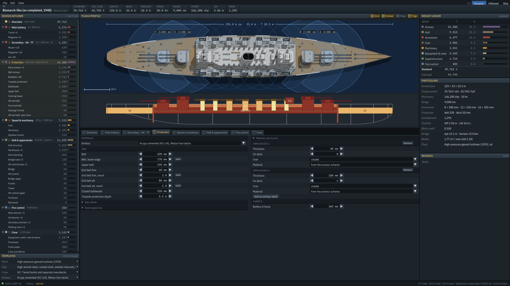

# Protection tab (mockup, 2026-10-11)

**Status:** this design is now the Protection tab, built in `Designer/DesignerScene.Protection.cs`, with the edits in
`Designer/ProtectionEdits.cs` (tests in `tests/Fleetwright.Tests/ProtectionEditsTests.cs`). Review decisions on the
second pass (2026-10-11): the three presets are fine (more can come if players keep wanting a layout); added parts take
their starting values from the belt; finer control (sloped decks, a conning tower of its own) gets UI when the engine
has it.

The game differs from the mockup in these ways:

- **A drag edits once, on release.** While the mouse is down its target is drawn where it would land: the belt (and
  the end belts, which share its heights) outlined at its new edges, the end belt to its new tip, the upper belt to its
  new deck, the armour deck on its new deck with that deck's name lit in the margin and a dashed line from where it is.
  The value is in a tooltip. The design changes (and the ship rebuilds) only when you let go, and not at all if the
  value didn't move. The wheel and the spinners step as everywhere else.
- **The drawings keep their frame.** The elevation's and the section's scale, and the top area's height, are set when
  the design opens and kept while the ship changes inside them, so a wheel step on a plate doesn't rescale the view.
  The frame grows when the ship outgrows it, shrinks only when the ship is far smaller, and resets for another design
  or pane size; a part added to the table can take height from the drawings, a part removed doesn't give it back.
- **The drawings are the built ship's**, from `Ship.Hitboxes` (belt, strakes, bulkheads, armour decks, barbettes,
  turrets, conning tower, the hull form's stations), so they lag an edit by one build. The table is the design.
- **Design decks and built decks:** the engine merges design decks that overlap on the same deck. A built deck plate
  belongs to the first design deck on that deck and extent, so clicking it selects that row.
- **Weights** come from the build's weight lines (the decks' by deck and extent). Turret armour is in each turret's
  weight, so its row says "turret".
- **Belt, bulkheads and conning tower materials** edit the armour scheme's own map (`Knobs.SchemeMaterial`); changing
  one makes the scheme custom. Barbettes are "as the turrets".
- **The arrow glyph (→) isn't in the UI fonts**, so the taper reads "to 170".
- **Scripted drags:** `-input=F:drag:X0,Y0:X1,Y1` moves, presses a frame later, moves in six steps and lets go, as a
  hand would (`Engine.ScriptedInput`).
- **Dev hook:** `-designer-ui=protsel:ID` (belt, upper, end_fore, end_aft, bulk, tds, deckN, steer, mainN, barb, ct),
  `protmenu` (its context menu), `protcover:N` (preset N's tooltip), `protghost:DECK:EXT` (that ghost hovered),
  `prothandle:N` / `protsechandle:N` (handle N's tooltip on the elevation or the section).

Game screenshots: `png/protection-game-bismarck.png` (hovering the second deck's `+`),
`png/protection-game-dreadnought-menu.png` (right-click on the third deck, fore end),
`png/protection-game-yamato-cover.png` (hovering "Armoured ends").

The rest of this note is the mockup's reasoning.

Mockup: `protection.html`. Open it in a browser; it is interactive and works offline. Like the other tab mockups it
shows **only the tab's pane** (1280 × 578, its size at 1920 × 1080). The plan, the outliner and the ledger stay as they
are.

URL options: `?ship=bismarck` (the default), `dreadnought` (armoured ends, decks over the fore and aft ends) or `yamato`
(all-or-nothing, steering gear box). For screenshots: `&sel=deck1` selects a plate; `&do=` edits, comma-separated
(`adddeck:1:citadel`, `deck0:-2` for steps, `add:end_fore`, `rm:upper`, `cover:aon`, `reach:end_fore:0.6`, `bh:3.4`);
`&tip=ghost:gh-1-citadel`, `&tip=cover:1` or `&tip=handle:2` draws a tooltip; `&menu=deck1` opens a plate's context
menu.

**What's real and what isn't:**

- **Real:** each ship's geometry (the belt, strakes, bulkheads, armour decks, barbettes, turrets, conning tower, the
  deck stack and the midship station) and its weight lines, from `shipgen design` builds of the shipped designs on
  2026-10-11.
- **Stand-in:** once you edit, the t column scales the opened build's line by area and thickness, and the drawings move
  the plates the way the engine would. The game shows the rebuilt ship.

## Review decisions (2026-10-11, first pass)

- **No deltas.** The tab shows weights (t, and the share of the armour), not one-step figures. That's the Overview's
  job.
- **The elevation keeps real heights**, stretched: they show the plates' relative sizes at a glance.
- **The immune zone stays as a greyed placeholder**, a fixed panel at the foot of the selected plate. It will hold the
  penetration model and a "1,000 shells fired in anger" run.
- **Engine rules stay read-only** (the conning tower takes the belt; barbettes 0.8 × the faces). When the engine
  changes, the UI changes with it.
- **Turret faces stay on both tabs**, here and on Main battery.

Second pass, from that review: make adding and removing parts simple, and coverage quick to change.

## Why the current tab is slow

Today the tab is the generic knob list: about 40 rows in two columns, with Side, Side details, Steering gear box and
Materials part by part folded away.

- **There's no picture of where the armour is.** The profile above the pane shows the plates, but small, and you can't
  click them. To see that Dreadnought's third deck is armoured over both ends but not under the citadel, you read three
  "Armour deck N" blocks.
- **An armour deck is four controls.** Thickness, "On deck" as a number (0 is the main deck, 2 the third), "Over" as a
  dropdown, and material. Adding one is: Add, then wheel the deck number, then pick the extent, then set the thickness.
- **A missing part is a row at 0.** There's no telling what the ship has from what it could have, and removing a part
  means spinning it to zero.
- **Related values sit far apart.** The belt's lower edge, its height above and depth below the waterline, and its
  material are in three different folds.

## The design

The pane has four parts under the sub-bar. The sub-bar names what the scheme reads as (all-or-nothing, incremental
with armoured ends, protected deck), the armour's weight and share of standard, the **coverage presets** and the armour
scheme (the same template as in the Templates panel).

### Adding and removing parts

The armour is a fixed set of parts: belt, upper belt, end belts fore and aft, citadel bulkheads, torpedo protection,
steering gear box, and any number of armour decks. The tab shows **only the parts the ship has**. Each one the ship
lacks is a dashed **`+` chip in its group's header** ("+ upper belt", "+ end belt fore", "+ steering gear box"), and
the decks group has a chip for each bare deck ("+ 2nd", "+ 4th"). One click adds the part with starting values taken
from the belt (upper belt half its thickness, end belts 0.4, bulkheads 0.7, decks 25 mm), and selects it.

Each row has a **`×`** at its end (or Del on the selected plate). Removing a part sets it to 0 in the design (a deck is
deleted), and it comes back as a `+` chip, and as a ghost on the elevation. Barbettes, the conning tower and the turret
faces can't be removed: the engine derives the first two, and the faces belong to the battery.

On the elevation, the same parts are `+` ghosts where they would go: a bare stretch of a deck (aft end, citadel, fore
end), the side above the belt (upper belt), the ends beside it (end belts), the stern over the rudders (steering gear
box). Hovering shows what it adds and its weight.

### Changing coverage

Coverage is where a plate reaches. There are three ways to change it, from the broadest to the finest:

1. **Coverage presets** in the sub-bar, a segmented control: **All-or-nothing · Armoured ends · Complete belt**. The
   design's own reading is lit. A preset moves extents and adds or drops the end armour; thicknesses stay. Its tooltip
   lists what it would do to this ship ("adds the end belt, fore 160 mm; adds the third deck, both ends 120 mm").
   All-or-nothing drops the end belts and every deck's armour over the ends, and brings the upper belt back to the
   citadel. Armoured ends adds both end belts and a deck over both ends, one deck below the roof. Complete belt does
   that and carries the upper belt the full length.
2. **Brass handles** on the drawings for the selected plate. Drag one, the value snaps, the drawing follows, and a
   tooltip shows the value:
   - the belt's **top and bottom edges** (0.1 m), on the elevation and on the section (the end belts share them);
   - an end belt's **tip**, horizontally: its reach, in tenths of the way to the stem or stern;
   - the upper belt's **top edge**, snapping deck to deck;
   - an armour deck, up or down, **snapping to another deck**;
   - the torpedo protection's **holding bulkhead**, in or out on the section (0.1 m).
3. **The row's controls**: an extent segment (cit · full · fore · aft · ends) for decks and the upper belt, a deck
   dropdown, the reach spinner, and the belt's ↓ ↑ heights. These are one click or one wheel step each.

There are no handles for the length of the citadel (the layout places it between the outermost barbettes) or for a
deck's extent. The engine's extents are fixed spans (the citadel, an end, both ends, the full length), not free ends,
so a drag would only jump between them, and the segment does that in one click.

### 1. Elevation (top left)

The ship's side, aft on the left as in the profile. The length is to scale and the heights are stretched (about ×2.4)
so that each deck is a lane, with its name in the margin.

- **Every plate is drawn where it is**, in the armour ramp's colour, labelled with its thickness: the belt (with its
  taper below the waterline), the upper belt, the end belts (root and tip), both citadel bulkheads (thinner below the
  belt), each armour deck on its own deck, the steering gear box, the barbettes (dashed inside the hull), the turrets
  and the conning tower. The torpedo protection is a hatched band under the roof deck.
- **Click** a plate to select it, **wheel** over it to step its thickness, **right-click** for its menu, **drag** its
  handles.
- The citadel is bracketed and its length shown.

### 2. Midship section (top right)

The midship station from the hull form, **to scale**, with the plates drawn three times as thick so they show: the belt
and upper belt on both sides (tapering below the waterline), every armour deck that crosses the station, and the
torpedo protection (the holding bulkhead `tds_m` in from the shell, inner bottom to the roof deck, hatched). The belt's
edges and the holding bulkhead have handles, and spinners beside them.

### 3. Plate table (bottom left)

One row per part the ship has, in four groups (side, armour decks, ends, guns and conning tower), with the `+` chips in
the group headers.

| Column | What it is |
|---|---|
| Thickness | spinner: ◀ ▶, wheel (Shift ×4), click to type. The torpedo protection's depth in m |
| Lower · tip · roof | the second value: the belt's lower edge (auto: the belt), the end belt's tip, the steering box's roof |
| Where | the belt's heights (↓ under and ↑ over the waterline); the upper belt's top deck (dropdown) and extent; an end belt's reach; an armour deck's deck (dropdown) and extent; the turret faces' side, rear and roof |
| Material | the scheme's material in grey, or the plate's own. A click picks one |
| t | the plate's weight, with the weight lines in the tooltip |
| of the armour | a bar and the plate's share of the armour's weight |
| × | remove |

### 4. Selected plate (bottom right)

What the plate covers (from–to along the ship, its length and share), its height (deck, or from–to on the waterline),
weight and share of standard, material, the taper, and a line on what the engine does with it ("Full thickness down to
the belt's lower edge, half below it"). The barbettes and the conning tower say which value they follow. At the foot,
the greyed **immune zone** panel: against which gun, where the belt and the deck hold, and "Fire 1,000 shells…".

### Clicks

| Task | Today | Here |
|---|---|---|
| Add an armour deck on the second deck over the citadel | Add, wheel "On deck" to 1, pick "Over", set the thickness | one click on "+ 2nd" (or the elevation's `+`) |
| Add end belts and an ends deck | two thicknesses, an Add, a deck number, an extent, a thickness | one click on "Armoured ends" |
| Remove the upper belt | spin it to 0 | `×` |
| Move a deck down one | wheel "On deck" | drag it down a lane, or the deck dropdown |
| Armour the ends of a deck | "Over" dropdown | one segment click |
| Raise the belt's top edge 0.6 m | open Side details, find the row, six wheel steps | drag the top edge |
| Shorten the fore end belt to 60 % | find "reach", four wheel steps | drag its tip |

## What the engine already does

Every control maps onto today's design fields (`armour` in the design JSON), so the port needs no engine changes:

- `belt_mm`, `belt_bottom_mm`, `belt_depth_m`, `belt_height_m`, `bulkhead_mm`, `tds_m`
- `upper_belt` {`mm`, `to_deck`, `extent`, `material`}
- `end_belts.fore|aft` {`mm`, `tip_mm`, `reach`, `bulkhead_mm`, `material`}
- `decks[]` {`deck`, `mm`, `extent` citadel · full · fore · aft · ends, `material`}
- `steering_box` {`mm`, `deck_mm`, `bulkhead_mm`, `material`, `deck_material`}
- `materials` (per part, from the armour scheme), and `main[].armour_mm` for the turret faces.

A part is "absent" when its thickness is 0 (a deck: when it isn't in `decks`), as the engine already reads it. These
are the engine's rules, and the tab only shows them:

- **The citadel's length** comes from the layout (the end barbettes).
- **The conning tower takes the belt's thickness**; it has no value of its own.
- **Barbettes are 0.8 × the turret faces**, and the gunhouse's side, rear and roof are fixed shares of the face (0.55,
  0.5, 0.4).
- **The citadel bulkheads are half thickness below the belt.** End belts are the belt's height.
- **The belt is a vertical plate on the shell.** There are no inclined belts or sloped deck edges.

## Engine note: one step can re-plan the ship

The first pass's probe builds found steps that cost far more than the plate, because the yard lays the ship out again
with a longer citadel. Bismarck: either armour deck ±5 mm costs +1,281 / +1,901 t (the plate alone ±171 t), with the
citadel 12.4 m longer. Yamato: armour deck +5 mm costs +4,054 t (the plate about 180 t), with the citadel going from
137.6 to 158.1 m. The tab no longer shows deltas, so this belongs to the Overview and to the layout. Whether a 5 mm
change *should* move the citadel by 12–20 m is a question for the layout.

## Port plan

- `Designer/DesignerScene.Protection.cs`: the four parts. The elevation and section draw from `Ship.Hitboxes`
  (`Armour`, `Decks`, the components and `HullForm` stations), never from the design, so they show what was built.
- The table's controls are the existing `Knobs` (Belt, BeltBottom, BeltDepth, BeltHeight, UpperBelt, UpperBeltToDeck,
  UpperBeltExtent, EndBelt*, Bulkheads, Tds, Deck*, Steering*, MainArmour, the material knobs). New helpers: add a part
  with starting values from the belt, add a deck at a given deck and extent, and the three coverage presets.
- The handles are ImGui drags over the drawing (an invisible button per handle, `IsItemActive` and the mouse delta),
  snapping as above. The edit is applied once per snap step, so a drag doesn't flood the build queue.
- A dev hook: `-designer-ui=protsel:ID,protmenu,protcover:N,protghost:DECK:EXT,protadd:ID`, and the `-input=` scripted
  clicks and drags to check every control once ported.

Screenshots: `png/protection-opened.png` (Bismarck as opened), `png/protection-ghost.png` (hovering the second deck's
`+` over the citadel), `png/protection-added-deck.png` (after adding it and thinning the main deck 10 mm),
`png/protection-dreadnought-menu.png` (right-click on Dreadnought's third deck, fore end),
`png/protection-cover-tip.png` (Yamato, hovering "Armoured ends"), `png/protection-dreadnought-aon.png` (Dreadnought
after "All-or-nothing"), `png/protection-handle-reach.png` (Bismarck without its upper belt and aft end belt, belt
raised to +3.4 m, dragging the fore end belt's tip to 0.6).
