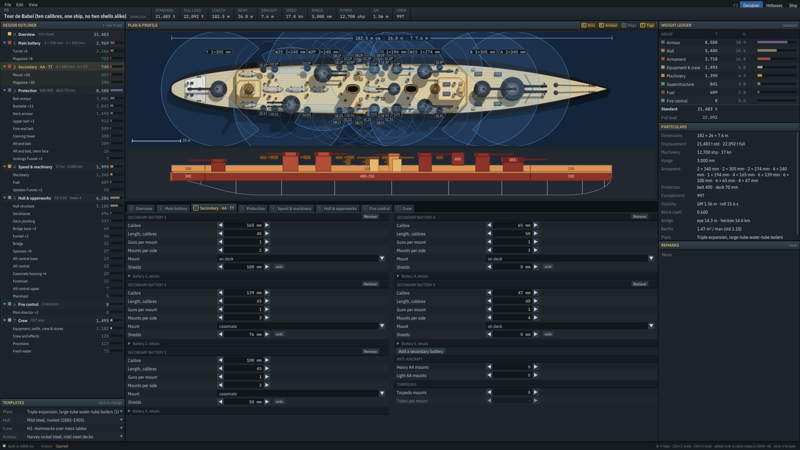

# Secondary · AA · TT tab (mockup, 2026-10-11)

**Status:** this design is now the Secondary · AA · TT tab, built in `Designer/DesignerScene.Secondary.cs`, with the
edits in `Designer/SecondaryArrangement.cs` (tests in `tests/Fleetwright.Tests/SecondaryArrangementTests.cs`). Review
decisions (2026-10-11): the tracks stay schematic (real heights are for the hitbox viewer and the drawing; this view is
semantic, so more kinds of mount can join it later); a track's `+` in another position starts a new battery, as mocked;
no engine asks for now (AA and torpedoes are placeholder systems, their panels get reworked with them); directors are
read-only here; no presets (the yard places the secondaries, so there is little to preset).

The game differs from the mockup in these ways:

- **The dashed engine-ask boxes are gone** (see above).
- **The places, arcs, heights and tonnes are the built ship's**, so they lag the table by one build, as on the main
  battery tab. A track's number is the mean gun axis height of its built mounts, or a nominal one when it's empty.
- **The arcs are the engine's:** today every deck secondary gets a flat 180° on its side, with no masking, so the rose is
  a full circle for a deck battery. Casemates get ±60° about the beam.
- **The yard lengthens the hull rather than leaving pairs out.** Placed `n/m` turns amber, and ghosts appear on the
  track, only while the last good ship is still shown after an edit, or when a build is capped.
- **The amidships bracket** is drawn between the end turrets (the main turrets beyond a fifth of the length from
  midships), since the layout's own stretch isn't in the hitboxes.
- **The tracks are packed** at a small fixed pitch along the bottom of the strip, and the plan takes the height above
  them at true proportions. Upper casemates are boxes like the lower ones, and the superstructure is a low roof band
  with a thin step per level above it: nothing in the schematic stretches to fill the space.
- **Position is a knob,** `sec{i}_pos` (`house`, `deck`, `upper`, `lower`), so `-steps=sec1_pos:upper` works.
- **A dev hook for screenshots:** `-designer-ui=` takes `sec:K` (select battery K), `secsel:K:N` (pair N of it),
  `secmenu` (its context menu), `secrose:all` (the rose with the main battery), `sectip:lane:P` / `sectip:short:K`
  (draw that tooltip) and `seclane:P` (press track P's `+`; P is 0 deckhouse, 1 deck, 2 upper, 3 lower casemate).

Game screenshots: `png/secondary-game-babel-menu.png`, `png/secondary-game-kongo-lane.png`,
`png/secondary-game-deutschland.png`.

The rest of this note is the mockup's reasoning.

Mockup: `secondary.html`. Open it in a browser; it is interactive and works offline. Screenshots are in
`png/secondary-*.png`. Like `mainbattery.html`, it shows **only the tab's pane** (1280 × 578, its size at
1920 × 1080). The plan, the outliner and the ledger stay as they are.

URL options: `?ship=bismarck` (the default), `kongo`, `babel` or `deutschland`. `&active=k` selects a battery.

**What's real and what isn't:**

- **Real:** the controls map one to one onto today's design fields (see "What the engine already does"). The t column
  and the rounds curve use the engine's own formulas (`Batteries.MountWeights`, `RoundsPerGun`).
- **Stand-ins:** placement, arcs and ship geometry. The game would draw them from the built layout.
- **Engine asks:** the dashed boxes marked "engine ask" are proposals that need engine work. They're drawn so you can
  judge whether they're worth it.

## Why the current tab is slow

Each battery is a 6-row knob list: calibre, length, guns per mount, mounts per side, a Mount dropdown and shields.
Rounds, casemate tier, "stands on" and material are behind a "Battery N, details" fold. AA and torpedoes get four rows
in the bottom-right corner. On Babel the five batteries fill the whole pane, in two columns.

- **Position is split across three controls in two places.** Where a gun stands is one question with four answers:
  on the deckhouse, on the deck, an upper casemate or a lower casemate. Today that's the Mount dropdown, plus Tier or
  Stands on behind the fold. Which of the two is shown depends on the dropdown.
- **No fit feedback where you edit.** You spin "Mounts per side" up and find out in Remarks ("Only 3 of 4 secondary
  mounts per side fit amidships"), or by counting tags on the plan.
- **You can't see where a battery goes.** Deck guns share the amidships stretch, battery order decides who gets the
  middle, and casemates have to keep clear of barbettes. None of that is on screen.
- **No comparing batteries.** Five batteries are five separate blocks.
- **AA and torpedoes are bare counts.** You don't see what got placed, where it went or what it weighs.

## The design

The pane has four parts, top to bottom.

### 1. Secondary battery table

One row per battery, all visible at once. Five rows fit; more scroll. Columns:

▴▾ order · colour + name (S, SB, SC… as the plan tags them) · calibre · length · guns per mount (segmented 1–6) ·
**position** · per side · **placed** · guns · shields · rounds (auto) · material · t · duplicate / remove

- **Position is one segmented control:** `deckhouse | deck` under "Turret on", and `upper | lower` under "Casemate".
  One click sets mount, tier and stands_on together. The gun axis height above the full-load waterline shows next to
  it (for example 4.6 m for a lower casemate). Height is the real trade-off: a lower casemate is low and wet, and a
  deckhouse mount adds top weight. Each button's tooltip explains its option.
- **Placed is `n/m`**, how many pairs the yard actually fitted out of how many you asked for. It turns amber when
  short, and its tooltip says where it ran out of room and what to change.
- **Guns and t count only what fits**, as the ledger does.
- **▴▾ order matters:** the first deck battery gets the middle of the amidships stretch, and the next ones fill
  outward. Lower casemates are placed before upper ones.
- Wheel over any spinner steps it, as everywhere in the designer.

### 2. Broadside strip

This is the main new view, and it shares one x scale with the hull:

- **Top band: half-plan, starboard only.** Deck mounts are circles, and casemates are boxes on the hull edge with
  their barrels pointing outboard. Main turrets and the superstructure are grey. AA mounts are white dots and torpedo
  tubes are blue bars. A bracket marks the **amidships stretch** that every deck and deckhouse gun shares.
- **Bottom band: four tracks, one per position**, top to bottom in height order: deckhouse, casemate ↑, deck and
  casemate ↓. The deck line and waterline are drawn, and the deckhouse sits under its track. The tracks are a
  schematic: a deck mount and an upper casemate sit only 0.2 m apart in real height, so true elevation would pile them
  on top of each other. The number by each track is the true gun axis height.
- **Pairs that don't fit** show as amber dashed ghosts at the end of their track, for example "SB ×2 no room".

Interactions:

- **Hover a mount:** highlights its battery row, and on the plan its tags. The tooltip gives name, gun, mount type
  (from the calibre: turret on a barbette ≥ 150 mm, shielded 76–150 mm, open below that), place, gun height and arcs.
- **Click a mount:** selects its battery, and the pair in the inspector.
- **Wheel over a mount:** per side ±1.
- **Right-click a mount:** move the battery to any of the four positions, "New battery from this pair", "Move this pair
  to S / SC / …", and "Remove this pair". **Del** also removes the selected pair.
- **The `+` at each track's head:** if the selected battery is already in that position, it adds one of its pairs.
  Otherwise it starts a new battery there with the selected battery's gun and one pair. That makes mixed
  arrangements, like two of the 6-inch guns up on the deckhouse and the rest in casemates, two clicks.

### 3. Guns bearing (right)

Secondary guns bearing at each bearing, stacked by battery in battery colours. A toggle adds the main battery. The
readouts are broadside port · stbd, ahead · astern, and guns per broadside by battery. This answers "how many of my
anti-torpedo-boat guns bear on one side". In the game it comes from the built mounts' arcs, like the main battery
rose.

### 4. AA, torpedoes and the inspector (bottom)

- **Anti-aircraft:** Heavy (quad 40 mm, step 1) and Light (single 20 mm, step 2), each with mounts, type, barrels,
  placed `n/m` and t. Below them:
  - **Placement:** how many mounts stand on roofs and how many at the deck edge. That's the top-weight story.
    Roof mounts also carry a tub (+3 t heavy, +0.3 t light).
  - **Directors:** the AA director count, with a link to Fire control.
  - When heavy AA takes the roofs, the light guns move to the deck edge, and the mockup shows it.
- **Torpedo tubes:** mounts and tubes per mount (segmented 1–5; more can be typed). Below them:
  - **Placed:** what the yard did with them, for example "1 pair abreast the after funnel". An odd count is rounded
    up to a pair, which the engine already warns about.
  - **Broadside:** tubes per side and torpedoes carried.
  - **Weight.**
- **Selected:** the selected battery, or the selected pair. It shows mount type and shield, place (how many per side
  and over which x range), gun height, ammunition and magazine tonnes, and the directors that serve it. Buttons:
  **Split a pair off**, **Duplicate**, **Remove a pair**.

## Click counts

| Task | Now | Mockup |
|---|---|---|
| Move a battery into lower casemates | Mount ▾ → casemate, open Details, Tier ▾ → lower | 1 (`lower`) |
| Raise deck guns onto the deckhouse | open Details, Stands on ▾ → deckhouse | 1 (`deckhouse`) |
| Twin mounts instead of singles | spinner ▶ | 1 (`2`) |
| Does a 5th pair fit? | spin, then read Remarks or count plan tags | the Placed column and the track ghost, live |
| Two of the casemate guns up on the deckhouse as turrets | add a battery, copy 4 gun knobs, set mount, open Details, set stands on, reduce the first battery | 2 (deckhouse track `+` twice), with the casemate battery selected |
| Move one pair to another battery | edit both batteries' per side | right-click → Move this pair to … |
| See where the AA went | read the plan | the Placement row and the dots on the strip |
| Compare batteries | scroll two columns of blocks | one table |

## What the engine already does (no engine change needed)

All of this maps onto today's fields: `secondary[k]` {`calibre_mm`, `calibre_length`, `barrels`, `per_side` |
`count`, `mount`, `tier`, `stands_on`, `armour_mm`, `rounds_per_gun`, `material`, `where`}, plus `aa` {`heavy`,
`light`} and `torpedoes` {`mounts`, `tubes`}.

- **Position:**
  - deckhouse = `mount: deck, stands_on: deckhouse`
  - deck = `mount: deck` (stands_on `deck` or absent)
  - upper = `mount: casemate, tier: upper`
  - lower = `mount: casemate` (tier `lower` or absent)

  Setting a position clears the field that no longer applies, because `Style.Validate` refuses `stands_on` on a
  casemate.
- **Placement (`BuildLayout`, secondaries on deck):** deck batteries are placed in list order. The first one is spread
  evenly about the middle of the amidships stretch, and the rest go nearest the middle where there is room. The
  "Only n of m … fit" failures already say where they ran out of room.
- **Placement (`LayoutWarship.PlaceCasemates`):** lower tier first, then upper, keeping clear of barbettes.
- **Mount type comes from the calibre (`MakeTurretType`):** turret on a barbette at 150 mm and up, shielded mount at
  76–150 mm, open below that.
- **AA (`PlaceAa`):** the slots are scored roofs first, then the deck edge, nearest the machinery. Roof mounts weigh
  more.
- **Torpedoes:** trainable mounts at the deck edges in pairs, else on the centreline, else on the deckhouse. The small
  craft style uses fixed tubes instead.

## Engine asks (optional; decide in review)

1. **AA mount types:** heavy `twin 40 | quad 40` and light `single 20 | twin 20`. `Geometry.AaCfg` already has
   `twin40` but nothing picks it. This needs `aa.heavy_mount` / `aa.light_mount` and a twin 20 entry. It is the
   biggest gap between "efficient" and "simplified" on this tab.
2. **Torpedo calibre and reloads:** `MakeTorpedoType` hard-codes 533 mm and carries no reloads. The asks are 450 / 533
   / 610 mm (weight and hitbox warhead scale with it) and 0 / 1 reload per tube (weight and magazine volume).

Without these, the dashed boxes are simply left out, and the tab is still complete for today's model.

## Porting to ImGui

- **`DesignerScene.Secondary.cs`**, a new partial like `DesignerScene.MainBattery.cs`. Section 2 gets its own body in
  place of `Flow`.
- **Table:** `ImGui.BeginTable` with the same compact cell spinners as the main battery table, through the existing
  `Knobs` (`sec{i}_cal`, `sec{i}_len`, …).
  - Position becomes a new `ChoiceKnob` `sec{i}_pos` (house / deck / upper / lower) that writes mount, tier and
    stands_on in one edit. `-steps=sec1_pos:upper` then works, and undo reads "SB: upper casemates".
- **Placed, guns, t:** from the built layout. Count the mounts with `Battery == prefix` (two per pair), and sum the
  `Mount`, `Magazine` and `Barbette` weights by mount id. These lag the worker by one build, like the main battery's
  t column and rose.
- **Strip:** a draw-list widget like the main arrangement.
  - Plan positions, `Casemate`, Base and Top come from `lay.Mounts`.
  - Blocks come from the layout's blocks, AA from `lay.Aa` (Base > 0.5 means a roof), and torpedo mounts by kind.
  - Gun axis height = Base + 0.55·(Top − Base) + depth − full-load draught. When a track is empty, it shows the
    nominal height for that position.
  - Ghosts are `per_side − placed`.
- **Edits**, each one undo step with a label:
  - `SetPosition(k, pos)`
  - `AddPairAt(pos, k)`: adds to k, or makes a new battery with k's gun
  - `SplitPair(k)`, `MovePair(k, j)`, `RemovePair(k)`
- **Rose:** `Overlay.Mounts` of kind secondary (and main when toggled), adding up the gun count.
- **Plan link:** hovering a mount or row highlights its tags on the plan, the same `SB2S` names. Clicking a secondary
  tag on the plan selects its pair.
- **Style gating:**
  - `deckhouse` only with `HasRaisedMounts`; casemates only with `HasCasemates`.
  - One battery only when `!TakesSecondaryList`: no `+ Battery`, and a track `+` in another position moves the
    battery there instead.
  - Carriers and merchants have no tiers. Their position control becomes `sides | ends` (`where`), and per side
    becomes a count when `ends`.
- No deltas, as elsewhere in this UI.

## Open questions

1. **Tracks vs true elevation:** is the schematic track view right, or would you rather see true heights and accept
   overlaps?
2. **Track `+` in another position:** should it start a new battery with the selected gun (as mocked), or move the
   selected battery there?
3. **Engine asks:** take AA mount types, torpedo calibre and reloads, both, or neither for now?
4. **Directors:** show the counts here read-only with a link (as mocked), or make them editable here too, since
   they're per battery type?
5. **Presets:** the main battery tab has arrangement presets. Is there a useful secondary equivalent, such as
   "pre-dreadnought casemates", "anti-TB 12-pdrs" or "DP turrets", or is the position control enough?
6. **Amidships stretch:** it's only shown as a bracket. Should it be editable (the deck secondaries' spread), or stay
   an output of the main battery and superstructure?
